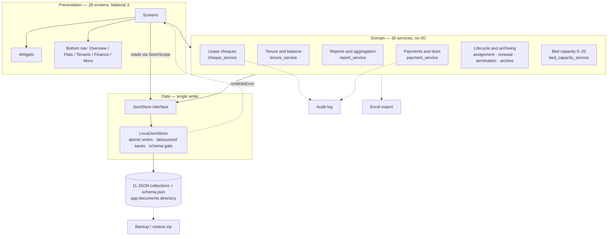

# Lucky — offline rental operations for small landlords

**Bed-level tenancy and finance tracking for landlords who rent individual beds across several flats. No account, no server, no internet — the Android app is the whole product.**


---

## Why this exists

A landlord with four flats and sixty beds does not track rent in a spreadsheet for long.
The unit of business is not "a property" or "a lease" — it is **one bed, one tenant, one month**.
Generic property apps assume a whole unit, a cloud account, and a stable connection; none of
those assumptions survive contact with how these buildings are actually run.

Lucky models the real domain:

- A flat holds **5–20 beds**, enforced everywhere.
- A bed holds **at most one active tenant**; a tenant holds **at most one active bed**.
- Rent is collected **per month**, deposits are collected once, and both are income.
- The landlord also pays a **recurring lease cheque** to each flat's owner, on a different schedule.
- Arrears are normal, partial payments are normal, and early exits are normal.

Everything is stored on the device. The app is used standing in a hallway with no signal, so
"offline-first" is not a feature — it is the constraint the data layer is designed around.

## Screenshots

> Screenshots and a short screen recording are being captured on a physical device.
> See [`docs/screenshots/README.md`](docs/screenshots/README.md) for the shot list and filenames.

<!--
Once the images exist, replace this comment with:

| Overview | Flats | Tenant | Finance |
|---|---|---|---|
|  |  |  |  |
-->

## What it does

| Area | Capability |
|---|---|
| **Occupancy** | Flats and beds with a hard 5–20 capacity rule; assign a tenant to a bed in one atomic step |
| **Tenancy lifecycle** | Assign → renew → terminate / abscond → auto-archive, with full history retained per person |
| **Money** | Rent and deposit payments, partial payments, arrears, per-month dues, month-by-month history |
| **Owner cheques** | Recurring lease cheque per flat, next-due scheduling, immutable paid-cheque archive |
| **Expenses** | Per-flat, per-month expenses folded into the same profit calculation as rent |
| **Reporting** | Dashboard totals, per-flat profit detail, 12-month table, signed net amounts |
| **Legal documents** | Per-flat document images copied into private app storage, never referenced from the picker cache |
| **Excel export** | Nine-sheet workbook for the accountant: read-me, summary, tenants, flats/beds, financial report, cheque history, rent history, expenses, legal docs |
| **Backup / restore** | Zip of all JSON collections plus photos, validated before a destructive restore |
| **Audit trail** | Before/after snapshots recorded for rent and expense edits, so a corrected payment is traceable |
| **Demo mode** | Sample dataset loadable on demand, refused if real data already exists |

## Architecture

The app is deliberately layered so that domain rules are plain Dart, not widget code.
Thirty services own the rules; every collection write goes through one store class.



**Why this shape:** every rule that can be wrong is a pure function over in-memory lists, so
the domain logic can be tested without a widget tree, a device, or a database. The store is an
interface, which is why 30 widget tests run against an in-memory fake instead of the disk.

## Domain rules and invariants

| Entity | Rule |
|---|---|
| `Flat` | Has 5–20 beds at all times. Creation, add-bed, and delete-bed all route through `BedCapacityService`. |
| `Bed` | Belongs to exactly one flat; holds at most one active person. |
| `Person` | Holds at most one active bed. Keeps payments and deposit history after move-out. |
| `Payment` | Bucketed by `YYYY-MM`; deposit is income **and** reduces the tenant's balance. |
| `Expense` | Attached to a flat and a date, folded into that month's net. |
| `LeaseChequeSetting` | One per flat; `yearlyRent ÷ (12 / intervalMonths)` by default (yearly rent ÷ 6 at the two-month default); next due date advances by interval when paid. |
| `LeaseChequeRecord` | Immutable snapshot created when a cheque is marked paid; never edited. |
| `Termination` / `LegalDocument` / `AuditLogEntry` | Append-only records tied to a flat or person. |

Balance math, used by both the tenant screen and the financial report:

```text
totalRentOwed     = monthlyRent × plannedStayMonths
remainingBalance  = totalRentOwed − deposit − Σ(rent payments)
monthlyNet        = (rent payments + deposits) − (expenses + lease cheques)
```

Month keys are generated in exactly one place (`monthKey()` in `config.dart`) so history,
reporting, and cheque scheduling cannot drift apart.

## Reliability decisions

These are the parts worth reviewing if you care about data integrity:

- **Atomic writes.** Every save writes `*.json.tmp` and renames it over the real file, so a
  crash mid-write can never truncate a collection. A stray `.tmp` is harmless.
- **Debounced persistence.** Rapid edits are coalesced; the UI never blocks on disk.
- **Schema gate.** `schema.json` carries a version. Data written by a newer app build is
  refused with an error screen instead of being silently corrupted.
- **Write failures surface.** `JsonStore.onWriteError` pushes disk problems back to the UI
  rather than failing silently.
- **Restore is validated first.** A backup zip is checked for every expected collection and
  summarised to the user before the destructive replace runs.
- **Money is never formatted per-screen.** Currency comes from one constant in `config.dart`.

## Testing

```text
$ flutter test
00:59 +376: All tests passed!
```

| Suite | Files | Covers |
|---|---|---|
| `test/unit` | 28 | Pure services: tenure, payments, reports, cheques, capacity, backup, audit, archive, Excel |
| `test/widget` | 30 | Every screen against an in-memory store, including validation and empty states |
| `test/integration_test` | 8 | Multi-screen flows: assign, payments, month rollover, tenant lifecycle, termination |
| `test/regression` | 1 | Named bug regression (`duplicate_title_regression_test`) |
| `integration_test/` | 1 | Device-level backup → restore round trip against a temp directory |

~8,700 lines of test code against ~16,700 lines of app code. Several tests exist specifically
because a real bug shipped once: the legal-docs grid refresh, the atomic-rename parent-directory
failure, and the month-bucket regression all have dedicated coverage.

`flutter analyze` reports **no issues**.

## Getting started

**Prerequisites:** Flutter 3.44+ (Dart 3.12+), Android SDK, a device or emulator.

```bash
git clone https://github.com/AnushGurung11/Dad-s-RealState.git
cd Dad-s-RealState/app
flutter pub get
flutter run
```

Run the full local gate:

```bash
flutter analyze
flutter test
flutter build apk --debug
```

Approve a demo dataset without touching real data: **More → Data → Load sample data**
(refused when real records exist).

## Project structure

```text
app/
  lib/
    main.dart              App shell, StoreLoader, 5-tab IndexedStack navigation
    config.dart            App name, file names, schema version, currency, monthKey()
    models/                10 immutable domain models
    services/              30 services: pure domain logic + JsonStore + backup + Excel
    screens/               28 screens
    widgets/               Shared UI: status badge, capacity hint, empty state, dialogs
    theme/                 Light theme tokens and typography scale
    navigation/            Named routes and bottom navigation
  test/                    unit · widget · integration_test · regression
  integration_test/        On-device backup/restore round trip
  android/                 Manifest declares no INTERNET permission
.github/
  workflows/ci.yml         analyze → test → debug APK artifact
  workflows/release.yml    signed APK → GitHub Release → optional Drive + Discord
  scripts/upload_drive.sh  Drive upload and notification helper
docs/screenshots/          Shot list and image drop location
```

## CI/CD

- **CI** (`ci.yml`) runs on every push and PR to `main`: `flutter analyze`, `flutter test`
  (376 tests), debug APK build, artifact upload. Currently green on `main`.
- **Release** (`release.yml`) runs on a `v*` tag or manual dispatch: builds a signed APK,
  renames it to `LUCK-<version>+<build>.apk`, publishes a GitHub Release, then optionally
  uploads to Google Drive and posts the link to Discord.
- Signing keys live only in repository secrets. Nothing sensitive is committed — see
  [`app/README.md`](app/README.md) for the secret list and the release runbook.

## Known limitations and next steps

Being explicit about the edges, because they are design decisions rather than oversights:

- **Android only.** iOS is intentionally not configured; there is no Mac in the loop.
- **Single device.** No sync or multi-user access — that is the point of the offline model,
  but it means backups are the recovery story.
- **Unencrypted at rest.** Data sits in the app's private sandbox; a database-level
  encryption layer is not implemented.
- **Money as `double`.** Works for this scale, but migrating to integer minor units is the
  correct long-term fix and is on the roadmap.
- **AED is fixed** in `config.dart`. Multi-currency would need a per-flat currency field in
  payments, reports, and exports.
- **No screenshot automation yet.** Manual capture list lives in `docs/screenshots/`.

## License

[MIT](LICENSE) © 2026 Anush Gurung

---

<sub>Built with Flutter and Material 3. No backend, no analytics, no network permission.</sub>
